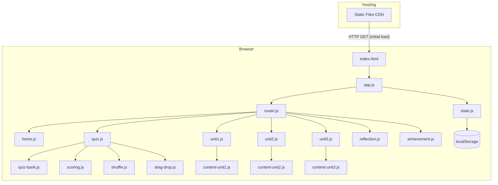
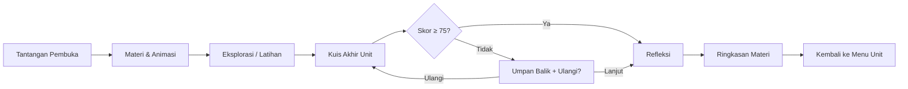
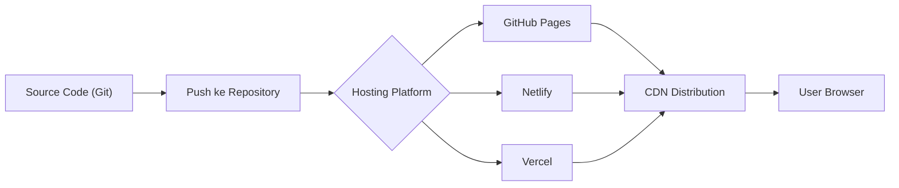

# 🏗️ Arsitektur Teknis (Architecture Document)

## Studio Informatika — Multimedia Pembelajaran Interaktif

---

## 1. Ringkasan Arsitektur

```
┌─────────────────────────────────────────────────────────┐
│                    BROWSER (Client-Side Only)            │
│                                                         │
│  ┌──────────┐  ┌──────────┐  ┌──────────┐              │
│  │  HTML5   │  │  CSS3    │  │ Vanilla  │              │
│  │  Pages   │  │ + Resp.  │  │    JS    │              │
│  └────┬─────┘  └────┬─────┘  └────┬─────┘              │
│       │              │             │                     │
│       └──────────────┼─────────────┘                     │
│                      │                                   │
│              ┌───────▼────────┐                          │
│              │   App Engine   │                          │
│              │  (JavaScript)  │                          │
│              └───────┬────────┘                          │
│                      │                                   │
│       ┌──────────────┼──────────────┐                    │
│       │              │              │                    │
│  ┌────▼─────┐  ┌─────▼────┐  ┌─────▼─────┐             │
│  │  State   │  │  Router  │  │  UI       │             │
│  │ Manager  │  │ (Hash)   │  │ Renderer  │             │
│  └────┬─────┘  └──────────┘  └───────────┘             │
│       │                                                  │
│  ┌────▼──────────┐                                       │
│  │  localStorage │  ← Satu-satunya persistence           │
│  └───────────────┘                                       │
│                                                         │
└─────────────────────────────────────────────────────────┘
         │
         │ Initial Load (HTTP GET)
         ▼
┌─────────────────────┐
│   Static Hosting    │
│  (Netlify/Vercel/   │
│   GitHub Pages)     │
└─────────────────────┘
```

> **Prinsip Utama:** Seluruh aplikasi berjalan 100% di sisi klien (browser). Tidak ada server aplikasi, tidak ada database, tidak ada API. Data pengguna hanya tersimpan di `localStorage`.
> 
> 📄 **Dokumentasi Terkait:**
> - Pemodelan aliran data lengkap: [dfd.md](file:///d:/1.%20COLLEGE/5.%20SEMESTER%205/MULTIMEDIA%20PEMBELAJARAN/FILE%20UNTUK%20BUAT%20WEBSITE/dfd.md)
> - Panduan opsi integrasi basis data: [database_guide.md](file:///d:/1.%20COLLEGE/5.%20SEMESTER%205/MULTIMEDIA%20PEMBELAJARAN/FILE%20UNTUK%20BUAT%20WEBSITE/database_guide.md)

---

## 2. Keputusan Arsitektur Utama

### 2.1 Static Site — Tanpa Backend

| Keputusan | Alasan |
|---|---|
| **Static website** — tanpa server aplikasi / database | Memenuhi syarat akses tanpa login & tanpa instalasi; murah/gratis untuk hosting; ringan dimuat |
| **Vanilla JS** — tanpa framework berat | Mengurangi ukuran bundle; cukup untuk kebutuhan interaktif yang ada; mudah dipelajari tim |
| **localStorage** sebagai satu-satunya penyimpanan | Tidak perlu akun; privasi data terjaga (tidak dikirim ke server); sesuai permintaan guru |

### 2.2 Konsekuensi Arsitektur

| Konsekuensi | Mitigasi |
|---|---|
| Data hilang jika browser/localStorage dihapus | Tampilkan peringatan di Petunjuk Penggunaan; fitur "Salin Intisari" untuk backup manual |
| Data tidak berpindah antar-perangkat | Siswa diminta konsisten menggunakan satu perangkat; skor bisa di-screenshot |
| Tidak ada dashboard guru real-time | Siswa menunjukkan layar Ringkasan Capaian kepada guru; skor dicatat manual |

---

## 3. Struktur Folder Proyek

```
studio-informatika/
├── index.html                    # Halaman Pembuka & Beranda (SPA entry)
├── css/
│   ├── main.css                  # Styles utama + design system tokens
│   ├── components.css            # Komponen UI (kartu, tombol, badge, dll.)
│   ├── quiz.css                  # Styles khusus kuis & soal
│   └── responsive.css            # Media queries (mobile-first)
├── js/
│   ├── app.js                    # Entry point, router, init
│   ├── state.js                  # State manager + localStorage wrapper
│   ├── router.js                 # Hash-based routing
│   ├── components/
│   │   ├── navbar.js             # Navigation bar
│   │   ├── progress-bar.js       # Bilah kemajuan
│   │   ├── card.js               # Kartu unit & kartu soal
│   │   ├── modal.js              # Modal dialog
│   │   ├── toast.js              # Notifikasi toast
│   │   └── audio-player.js       # Narasi audio controller
│   ├── pages/
│   │   ├── home.js               # Halaman Pembuka + Beranda
│   │   ├── unit1.js              # Unit 1: Arsitektur Von Neumann
│   │   ├── unit2.js              # Unit 2: Alur IPO
│   │   ├── unit3.js              # Unit 3: Siklus FDE
│   │   ├── quiz.js               # Engine kuis (shared)
│   │   ├── reflection.js         # Halaman refleksi (shared)
│   │   ├── summary.js            # Ringkasan materi per unit
│   │   └── achievement.js        # Ringkasan Capaian akhir
│   ├── data/
│   │   ├── content-unit1.js      # Data konten materi Unit 1
│   │   ├── content-unit2.js      # Data konten materi Unit 2
│   │   ├── content-unit3.js      # Data konten materi Unit 3
│   │   ├── quiz-bank.js          # Bank soal 30 butir (K + L)
│   │   └── feedback-map.js       # Mapping umpan balik per soal
│   └── utils/
│       ├── scoring.js            # Perhitungan skor & poin
│       ├── shuffle.js            # Pengacakan opsi jawaban
│       ├── drag-drop.js          # Engine drag & drop
│       └── animation.js          # Helper animasi diagram
├── assets/
│   ├── images/
│   │   ├── diagrams/             # Diagram Von Neumann, IPO, FDE
│   │   ├── icons/                # Ikon komponen & UI
│   │   └── illustrations/        # Ilustrasi dekoratif
│   ├── audio/
│   │   ├── narration/            # File narasi per segmen
│   │   └── sfx/                  # Sound effects (opsional)
│   └── fonts/                    # Outfit + DM Sans (fallback)
├── docs/
│   ├── prd.md
│   ├── arsitek.md
│   ├── data-model.md
│   ├── scoring.md
│   ├── content-map.md
│   ├── ui-spec.md
│   └── user-flow.md
└── README.md
```

---

## 4. Diagram Komponen



---

## 5. Arsitektur Data (localStorage)

### 5.1 Skema Penyimpanan

Semua data disimpan dalam satu key di localStorage:

```javascript
// Key: "studio-informatika-progress"
{
  "version": "1.0",
  "lastUpdated": "2026-11-05T13:00:00+08:00",
  "preferences": {
    "audioEnabled": true,
    "fontSize": "normal"
  },
  "units": {
    "unit1": {
      "status": "completed",          // "locked" | "in-progress" | "completed"
      "challengeAnswer": "...",       // Jawaban tantangan pembuka
      "explorationProgress": 4,       // Jumlah komponen yang sudah diketuk (max 4)
      "quiz": {
        "attempts": 1,
        "firstAttemptScore": 88.3,    // Skor ketercapaian (tidak berubah)
        "bestScore": 88.3,
        "answers": { "K1-1": "A", "K1-2": "A", ... },
        "points": 53
      },
      "practice": {
        "completed": ["L1-1", "L1-2", "L1-4"],
        "bonusPoints": 6
      },
      "reflection": {
        "scale": 4,
        "hardestPart": "Tidak ada, sudah paham",
        "selfExplanation": "...",
        "points": 10
      },
      "totalPoints": 90
    },
    "unit2": { /* struktur sama */ },
    "unit3": { /* struktur sama */ }
  },
  "overall": {
    "totalPoints": 285,
    "level": 3,
    "levelName": "Master Arsitektur",
    "completedUnits": 3,
    "averageQuizScore": 95
  }
}
```

### 5.2 Strategi Auto-Save

```
User Action → State Manager → Update In-Memory State → Debounce (500ms) → Write localStorage
                    │
                    └→ Re-render affected UI components
```

- **Debounce 500ms** untuk mengurangi write frequency
- **Auto-save indicator** di UI ("Autosave tersinkron ✓")
- **Version field** untuk migrasi data jika skema berubah

---

## 6. Routing

### 6.1 Hash-Based Routing

Media menggunakan **hash routing** agar bisa di-host sebagai static site tanpa server-side routing.

| Route | Halaman |
|---|---|
| `#/` | Halaman Pembuka & Beranda |
| `#/tujuan` | Tujuan Pembelajaran |
| `#/petunjuk` | Petunjuk Penggunaan |
| `#/unit/1` | Unit 1: Arsitektur Von Neumann |
| `#/unit/1/quiz` | Kuis Unit 1: Mencocokkan Komponen |
| `#/unit/1/reflection` | Refleksi Unit 1 |
| `#/unit/1/summary` | Ringkasan Materi Unit 1 |
| `#/unit/2` | Unit 2: Alur IPO |
| `#/unit/2/quiz` | Kuis Unit 2: Drag & Drop |
| `#/unit/2/reflection` | Refleksi Unit 2 |
| `#/unit/2/summary` | Ringkasan Materi Unit 2 |
| `#/unit/3` | Unit 3: Siklus FDE |
| `#/unit/3/quiz` | Kuis Unit 3: Prediksi |
| `#/unit/3/reflection` | Refleksi Unit 3 |
| `#/unit/3/summary` | Ringkasan Materi Unit 3 |
| `#/achievement` | Ringkasan Capaian Akhir |

### 6.2 Navigasi Antar-Tahap



> **Catatan:** Peserta didik tetap bisa melanjutkan ke unit berikutnya meskipun skor di bawah ambang. Ambang hanya berupa saran.

---

## 7. Interaktivitas — Komponen Kunci

### 7.1 Diagram Interaktif (Unit 1)

```
┌──────────────────────────────────────────┐
│  Ruang Eksplorasi Interaktif             │
│                                          │
│  ┌──────────┐    ┌──────────┐            │
│  │ 1. Unit  │    │ 2. CPU   │  ← AKTIF  │
│  │   Input  │    │ (CU+ALU) │            │
│  └──────────┘    └──────────┘            │
│  ┌──────────┐    ┌──────────┐            │
│  │ 3. Memori│    │ 4. Unit  │            │
│  │   Utama  │    │  Output  │            │
│  └──────────┘    └──────────┘            │
│                                          │
│  [Ketuk setiap bagian untuk membuka      │
│   fungsinya]        Status: 2/4 Lengkap  │
└──────────────────────────────────────────┘
```

**Implementasi:**
- Setiap komponen adalah elemen `<div>` dengan `onclick` handler
- Ketuk → expand panel detail di samping/bawah
- Progress tracker: `explorationProgress` di state

### 7.2 Drag & Drop (Unit 2 Kuis)

```
Skenario: "Siti melakukan video call..."

┌─────────────┐   ┌─────────────┐   ┌─────────────┐
│  DROP ZONE  │   │  DROP ZONE  │   │  DROP ZONE  │
│   INPUT     │   │   PROCESS   │   │   OUTPUT    │
│             │   │             │   │             │
│  [seret     │   │  [seret     │   │  [seret     │
│   ke sini]  │   │   ke sini]  │   │   ke sini]  │
└─────────────┘   └─────────────┘   └─────────────┘

Draggable items:
┌─────────────┐ ┌─────────────┐ ┌─────────────┐
│ Webcam      │ │ CPU kompresi│ │ Monitor     │
│ menangkap   │ │ frame video │ │ menampilkan │
└─────────────┘ └─────────────┘ └─────────────┘
```

**Implementasi:**
- HTML5 Drag and Drop API + Touch Events (untuk mobile)
- Custom `drag-drop.js` utility
- Validasi posisi → umpan balik visual (hijau/merah)

### 7.3 Simulasi CPU (Unit 3)

```
┌──────────────────────────────────────────────────┐
│  Simulasi Langkah demi Langkah di Dalam CPU      │
│                                                  │
│  ┌────────┐    ┌────────────┐    ┌────────────┐  │
│  │ FETCH  │ →  │   DECODE   │ →  │  EXECUTE   │  │
│  │  ✓     │    │ ● AKTIF    │    │   ?        │  │
│  └────────┘    └────────────┘    └────────────┘  │
│                                                  │
│  ┌────────────────────┐  ┌────────────────────┐  │
│  │ CPU                │  │ MEMORI RAM         │  │
│  │ ┌──────────────┐   │  │ 0x00A1: ADD 5, 3  │  │
│  │ │ Control Unit │   │  │ 0x00A2: STORE R3  │  │
│  │ │ IR: [0001...] │  │  │ 0x00A3: HALT      │  │
│  │ └──────────────┘   │  │                    │  │
│  │ ┌──────┐ ┌───────┐ │  │                    │  │
│  │ │ ALU  │ │ Regs  │ │  │                    │  │
│  │ └──────┘ └───────┘ │  │                    │  │
│  └────────────────────┘  └────────────────────┘  │
│                                                  │
│  [◀ Langkah Sebelumnya] [Ulang] [Jalankan ▶]     │
└──────────────────────────────────────────────────┘
```

**Implementasi:**
- State machine dengan 3 state: FETCH → DECODE → EXECUTE
- Animasi highlight pada komponen yang aktif
- Peserta didik menekan tombol untuk maju ke langkah berikutnya
- Penjelasan kontekstual muncul di panel samping

---

## 8. Performa & Optimasi

| Aspek | Strategi |
|---|---|
| **Gambar** | Format WebP dengan fallback PNG; lazy loading; ukuran max 200KB/gambar |
| **Audio** | Format MP3; kompresi 64kbps mono; lazy loading; preload hanya untuk unit aktif |
| **CSS** | Satu file CSS (< 50KB); no external CSS framework; CSS custom properties untuk theming |
| **JS** | Modular ES6 dengan dynamic import per halaman; no heavy framework |
| **Font** | Google Fonts (Outfit + DM Sans) dengan `font-display: swap`; system font fallback |
| **Total** | Target total bundle < 5 MB termasuk semua assets |

---

## 9. Keamanan & Privasi

| Aspek | Detail |
|---|---|
| **Data** | Tidak ada data yang dikirim ke server manapun |
| **localStorage** | Data hanya bersifat lokal, per-domain, per-browser |
| **Cookies** | Tidak ada cookies yang digunakan |
| **Tracking** | Tidak ada analytics/tracking pihak ketiga |
| **HTTPS** | Wajib — hosting platform menyediakan SSL gratis |

---

## 10. Deployment



| Opsi Hosting | Kelebihan | Cocok? |
|---|---|---|
| **GitHub Pages** | Gratis, mudah setup, custom domain | ✅ Rekomendasi utama |
| **Netlify** | Gratis tier, auto-deploy, form handling | ✅ Alternatif |
| **Vercel** | Gratis tier, fast CDN | ✅ Alternatif |

**Deployment Steps:**
1. Push kode ke repository GitHub
2. Aktifkan GitHub Pages dari branch `main` / folder `docs`
3. (Opsional) Hubungkan custom domain
4. Website langsung bisa diakses

---

## 11. Referensi Silang

| Dokumen | Relasi |
|---|---|
| [`prd.md`](prd.md) | Kebutuhan fungsional & non-fungsional |
| [`data-model.md`](data-model.md) | Skema localStorage detail |
| [`scoring.md`](scoring.md) | Logika perhitungan skor & poin |
| [`ui-spec.md`](ui-spec.md) | Design system & komponen UI |
| [`user-flow.md`](user-flow.md) | Alur navigasi pengguna |
| [`content-map.md`](content-map.md) | Pemetaan konten per unit |
