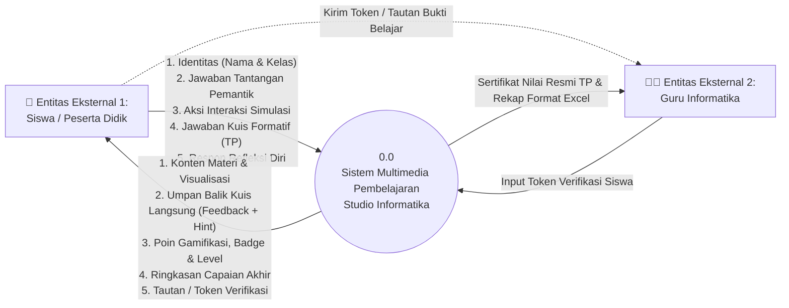
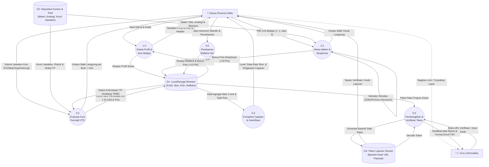
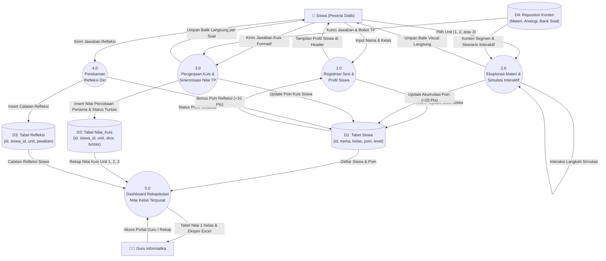

# 📊 Dokumentasi Lengkap Data Flow Diagram (DFD) — Studio Informatika

Buku panduan dan spesifikasi formal **Data Flow Diagram (DFD)** untuk media pembelajaran interaktif *Studio Informatika (Fase E - Sistem Komputer)*.

---

## DAFTAR ISI
1. [Konsep & Notasi DFD](#1-konsep--notasi-dfd)
2. [Entitas Eksternal (External Entities)](#2-entitas-eksternal-external-entities)
3. [DFD Level 0: Diagram Konteks](#3-dfd-level-0-diagram-konteks)
4. [DFD Level 1: Dekomposisi Proses (Versi Client-Side & Database)](#4-dfd-level-1-dekomposisi-proses)
5. [Rincian Narasi Setiap Proses (1.0 s/d 6.0)](#5-rincian-narasi-setiap-proses)
6. [Kamus Data Formal (Data Dictionary)](#6-kamus-data-formal-data-dictionary)
7. [Spesifikasi Data Store (Tempat Penyimpanan)](#7-spesifikasi-data-store)
8. [Panduan Menjawab Pertanyaan Dosen / Penguji Sidang](#8-panduan-menjawab-pertanyaan-dosen--penguji-sidang)
9. [Template Re-Prompt AI (Siap Salin & Pakai Ulang)](#9-template-re-prompt-ai)

---

## 1. Konsep & Notasi DFD

Data Flow Diagram (DFD) adalah representasi grafis dari aliran data yang melalui suatu sistem informasi. DFD memodelkan:
- **Dari mana data berasal** (*Source / External Entity*)
- **Proses apa yang mengubah data tersebut** (*Process*)
- **Ke mana data disimpan** (*Data Store*)
- **Ke mana hasil akhir data dikirimkan** (*Destination / Sink*)

### Simbol Notasi yang Digunakan (Standar Gane & Sarson / Yourdon & DeMarco):
1. **Entitas Eksternal (Persegi Panjang):** Aktor manusia atau sistem luar yang berinteraksi langsung dengan sistem (`Siswa` dan `Guru`).
2. **Proses (Lingkaran / Persegi Ujung Bulat):** Transformasi komputasi yang menerima data input dan menghasilkan output (`1.0`, `2.0`, dst.).
3. **Aliran Data (Panah Berlabel):** Jalur dan nama paket data yang bergerak.
4. **Data Store (Dua Garis Sejajar / Silinder):** Tempat data beristirahat (*data at rest*). Pada sistem ini berupa `LocalStorage Browser` (Opsi A) atau `Tabel MySQL` (Opsi B).

---

## 2. Entitas Eksternal (External Entities)

| Kode | Nama Entitas | Deskripsi & Peran dalam Sistem |
|---|---|---|
| **E1** | **Siswa (Peserta Didik)** | Pengguna utama yang memasukkan identitas diri (nama/kelas), mempelajari materi, mengoperasikan simulasi, menjawab kuis formatif, mengisi refleksi, dan membagikan token laporan capaian. |
| **E2** | **Guru Informatika** | Pendidik yang memvalidasi hasil ketuntasan belajar siswa per Tujuan Pembelajaran (TP), memeriksa lembar nilai resmi, serta merekap nilai kelas ke dalam format spreadsheet (Excel/Google Sheets). |

---

## 3. DFD Level 0: Diagram Konteks

Diagram Konteks memandang sistem sebagai satu kesatuan proses tunggal (*Black Box* bernomor 0.0) yang menghubungkan seluruh entitas eksternal.



---

## 4. DFD Level 1: Dekomposisi Proses

### 4.1 Versi A: Client-Side Architecture (LocalStorage & Token Payload)
*Digunakan jika sistem 100% mandiri tanpa web server/database lokal.*



---

### 4.2 Versi B: Server-Side Database Architecture (MySQL + Laragon)
*Digunakan jika sistem dihubungkan ke server database lokal Laragon di laboratorium komputer.*



---

## 5. Rincian Narasi Setiap Proses (1.0 s/d 6.0)

Berikut adalah penjelasan detail untuk setiap bulatan proses (*Process Specification*):

### Proses 1.0: Kelola Profil & Sesi Belajar
* **Tujuan:** Mengidentifikasi peserta didik yang sedang belajar tanpa memerlukan proses registrasi/login yang rumit.
* **Input Data:** `Nama Siswa`, `Kelas` (diinput melalui form modal atau header).
* **Logika / Transformasi:**
  1. Memeriksa apakah data siswa sudah ada di `LocalStorage` / `Tabel Siswa`.
  2. Jika belum ada, buat entri profil baru dengan status default (Total Poin = 0, Level = 1 "Pemula").
  3. Memuat status preferensi (seperti audio on/off).
* **Output Data:** Profil aktif ditampilkan pada navbar (`Nama (Kelas)` dan lencana poin).
* **Data Store:** Menyimpan dan membaca dari `D1 (LocalStorage / Tabel Siswa)`.

---

### Proses 2.0: Akses Materi & Eksplorasi Interaktif
* **Tujuan:** Menyajikan materi komputasi bertahap dan menjalankan simulasi interaktif untuk membangun pemahaman konsep.
* **Input Data:** Pilihan unit belajar dari siswa (`Unit 1`, `Unit 2`, atau `Unit 3`) serta aksi interaktif (misal: klik komponen Von Neumann, drag-and-drop IPO, atau klik tombol siklus Fetch/Decode/Execute).
* **Logika / Transformasi:**
  1. Mengambil materi segmen dari `D2 (Content Repository)`.
  2. Memvalidasi aksi simulasi siswa (misalnya memeriksa apakah urutan instruksi siklus FDE sudah benar).
  3. Memberikan poin eksplorasi sebesar +20 poin setelah simulasi diselesaikan untuk pertama kali.
* **Output Data:** Tampilan visual materi, teks analogi restoran/kehidupan nyata, animasi diagram, dan lencana penyelesaian latihan.
* **Data Store:** Membaca dari `D2 (Content Repository)`, meng-update poin ke `D1`.

---

### Proses 3.0: Evaluasi Kuis Formatif (Tujuan Pembelajaran)
* **Tujuan:** Mengukur ketercapaian Tujuan Pembelajaran (TP) peserta didik melalui 5 butir soal formatif berjenjang per unit.
* **Input Data:** Jawaban kuis siswa (Pilihan Ganda biasa, Pasangan/Matching, atau Pengurutan/Ordering).
* **Logika / Transformasi:**
  1. Mencocokkan jawaban siswa dengan `Kunci Jawaban` pada `D2`.
  2. Menampilkan umpan balik seketika (*instant feedback*) berupa status Benar/Salah, penjelasan konseptual, dan petunjuk (*hint*).
  3. **Aturan Penguncian Skor TP:** Skor percobaan pertama (*first attempt*) dikonversi ke skala 0–100 dan dikunci sebagai nilai resmi TP (KKM Unit 1 & 2 = 75, Unit 3 = 80).
  4. Pengulangan kuis diperbolehkan untuk latihan mandiri, tetapi nilai resmi TP tetap menggunakan percobaan pertama.
* **Output Data:** Umpan balik per butir soal, ringkasan skor kuis (0–100), status ketuntasan (*Tuntas* atau *Perlu Penguatan*), dan tambahan poin gamifikasi.
* **Data Store:** Membaca `D2 (Bank Soal)`, menyimpan skor resmi ke `D1 (LocalStorage / Tabel Nilai)`.

---

### Proses 4.0: Perekaman Refleksi Diri
* **Tujuan:** Memfasilitasi metakognisi peserta didik (evaluasi diri atas apa yang sudah dipahami dan apa yang masih membingungkan).
* **Input Data:** 3 butir respon refleksi (skala pemahaman 1–4, bagian tersulit, dan strategi perbaikan).
* **Logika / Transformasi:**
  1. Memvalidasi bahwa seluruh pertanyaan refleksi telah diisi.
  2. Memberikan penghargaan +10 poin apresiasi atas kejujuran evaluasi diri.
* **Output Data:** Status refleksi selesai (*Completed*) dan pesan penguatan.
* **Data Store:** Menyimpan respon refleksi ke `D1 (LocalStorage / Tabel Refleksi)`.

---

### Proses 5.0: Kompilasi Capaian & Gamifikasi
* **Tujuan:** Mengagregasi seluruh aktivitas belajar siswa ke dalam metrik prestasi belajar yang komprehensif.
* **Input Data:** Seluruh catatan nilai kuis, poin aktivitas, dan status tuntas dari 3 unit.
* **Logika / Transformasi:**
  1. Menghitung rata-rata skor kuis:
     $$\text{Rata-Rata} = \frac{\text{Skor Unit 1} + \text{Skor Unit 2} + \text{Skor Unit 3}}{3}$$
  2. Menghitung akumulasi total poin (maksimal 330 poin).
  3. Menentukan level gamifikasi:
     - Level 1: Pemula (0–99 Poin)
     - Level 2: Penjelajah Logika (100–199 Poin)
     - Level 3: Arsitek Sistem (200–259 Poin)
     - Level 4: Master Komputasi (260–330 Poin)
* **Output Data:** Halaman Ringkasan Capaian Akhir (*Achievement View*), bilah kemajuan level (*progress bar*), dan efek konfeti kelulusan.
* **Data Store:** Membaca seluruh data agregat dari `D1`.

---

### Proses 6.0: Pembangkitan Laporan & Verifikasi Guru
* **Tujuan:** Menyediakan bukti otentik capaian belajar siswa kepada guru mata pelajaran tanpa hambatan akun login.
* **Logika Dua Alur:**
  * **Alur Client-Side (Opsi A):**
    1. Sistem mengemas profil siswa dan nilai TP ke dalam objek JSON ringkas.
    2. Mengonversi data menjadi string Base64 yang aman URL (*Report Token*).
    3. Menghasilkan tautan unik: `#/verifikasi?data=<TOKEN>`.
    4. Guru membuka tautan tersebut untuk mendekode data dan melihat lembar verifikasi resmi serta menyalin format baris Excel (*TSV row*).
  * **Alur Database Laragon (Opsi B):**
    1. Sistem secara otomatis melakukan query agregat (`SELECT ... GROUP BY siswa.id`).
    2. Menampilkan tabel daftar seluruh siswa se-kelas dalam satu layar guru beserta fitur unduh Excel.
* **Output Data:** Sertifikat digital verifikasi capaian TP dan rekap nilai siap impor ke buku nilai guru.
* **Data Store:** Membaca/menulis ke `D3 (Token Stream)` atau `Tabel MySQL`.

---

## 6. Kamus Data Formal (Data Dictionary)

Kamus data mendefinisikan komposisi elemen data yang mengalir dalam DFD:

### 1. `Data_Identitas_Siswa`
* **Definisi:** Data pengenal peserta didik.
* **Komposisi:**
  ```text
  Data_Identitas_Siswa = Nama_Lengkap + Kelas + (ID_Perangkat)
  Nama_Lengkap         = String [3..100 karakter]
  Kelas                = String [contoh: "X-1", "X-2"]
  ```

### 2. `Jawaban_Kuis_Siswa`
* **Definisi:** Paket data masukan saat siswa menyelesaikan butir soal.
* **Komposisi:**
  ```text
  Jawaban_Kuis_Siswa   = ID_Unit + ID_Soal + Tipe_Soal + Jawaban_Dipilih
  Tipe_Soal            = ["multiple_choice" | "matching" | "ordering"]
  Jawaban_Dipilih      = Kunci_Opsi | Pasangan_Item | Urutan_Langkah
  ```

### 3. `Hasil_Evaluasi_Kuis`
* **Definisi:** Data hasil penilaian kuis formatif per unit.
* **Komposisi:**
  ```text
  Hasil_Evaluasi_Kuis  = Skor_Percobaan_Pertama + Status_Ketuntasan + Poin_Didapat + Catatan_Feedback
  Skor_Percobaan_Pertama = Integer [0..100]
  Status_Ketuntasan    = ["Tuntas" | "Perlu Penguatan"] (KKM >= 75 atau >= 80)
  Poin_Didapat         = Integer [0..60]
  Catatan_Feedback     = Teks penjelasan konsep benar/salah
  ```

### 4. `Payload_Token_Laporan`
* **Definisi:** String terenkripsi Base64 URL-safe untuk verifikasi guru.
* **Komposisi:**
  ```text
  Payload_Token_Laporan = Base64_Encode(Nama + Kelas + Skor_U1 + Skor_U2 + Skor_U3 + Rata_Rata + Total_Poin + Level + Timestamp)
  ```

---

## 7. Spesifikasi Data Store (Tempat Penyimpanan)

### Data Store D1: LocalStorage Browser (Kunci: `studio-informatika-progress`)
```json
{
  "student": {
    "name": "Muhammad Ghazi",
    "class": "X-2",
    "createdAt": "2026-11-09T08:00:00Z"
  },
  "overall": {
    "totalPoints": 310,
    "maxPoints": 330,
    "level": 4,
    "levelName": "Master Komputasi",
    "completedUnits": 3,
    "averageQuizScore": 88
  },
  "units": {
    "unit1": {
      "status": "completed",
      "quiz": { "firstAttemptScorePercent": 85, "points": 50 },
      "reflection": { "completed": true }
    },
    "unit2": { "status": "completed", "quiz": { "firstAttemptScorePercent": 90 } },
    "unit3": { "status": "completed", "quiz": { "firstAttemptScorePercent": 90 } }
  }
}
```

---

## 8. Panduan Menjawab Pertanyaan Dosen / Penguji Sidang

Berikut adalah contekan ilmiah jika penguji menanyakan aspek DFD ini saat ujian:

#### ❓ Pertanyaan 1: "Mengapa kamu memilih menggunakan DFD, bukan Flowchart saja?"
> **Jawaban:**  
> *"Flowchart berfokus pada urutan langkah eksekusi kontrol program (control flow) dari satu instruksi ke instruksi berikutnya. Sementara DFD (Data Flow Diagram) berfokus pada **aliran dan transformasi data (data transformation)** di dalam sistem. DFD memetakan secara jelas data apa yang masuk dari siswa, proses apa yang mengolahnya (seperti evaluasi kuis dan perhitungan level), serta di mana data tersebut disimpan dan bagaimana guru menerimanya. Oleh karena itu, DFD jauh lebih tepat untuk memodelkan arsitektur sistem informasi."*

#### ❓ Pertanyaan 2: "Sistemmu kan tidak pakai database MySQL/Oracle, apakah sah menggambarkan simbol Data Store di DFD?"
> **Jawaban:**  
> *"Sangat sah, Pak/Bu. Menurut literatur rekayasa perangkat lunak standar Gane & Sarson maupun Yourdon & DeMarco, simbol **Data Store (D)** tidak didefinisikan secara eksklusif sebagai database RDBMS fisik, melainkan sebagai **data at rest (tempat data beristirahat/disimpan)**. Dalam aplikasi web modern, browser `localStorage` dan payload URL token adalah media penyimpanan data persisten lokal yang sah secara teknis dan metodologis."*

#### ❓ Pertanyaan 3: "Bagaimana cara guru memverifikasi bahwa siswa tidak mencurangi nilai kuisnya?"
> **Jawaban:**  
> *"Pada sistem ini diterapkan aturan **First Attempt Lock**. Hanya skor pada percobaan kuis pertama yang dicatat dan dikunci sebagai nilai resmi Tujuan Pembelajaran (TP). Ketika siswa membagikan hasil ke guru, sistem membangkitkan string token Base64 yang berisi stempel waktu dan rincian skor. Guru dapat membuka portal verifikasi resmi untuk memeriksa integritas data tersebut secara langsung tanpa perlu registrasi akun."*

---

## 9. Template Re-Prompt AI (Siap Salin & Pakai Ulang)

Salin teks di bawah ini jika kamu ingin meminta AI lain membuat ulang diagram, mengonversi ke format Visio, Draw.io XML, atau membuat laporan skripsi:

```text
Saya sedang menyusun dokumen rekayasa perangkat lunak untuk aplikasi "Studio Informatika", yaitu multimedia pembelajaran interaktif berbasis web untuk siswa SMA Fase E materi Sistem Komputer (Arsitektur Von Neumann, Alur IPO, dan Siklus FDE).

Aplikasi ini memiliki 2 entitas eksternal: Siswa dan Guru Informatika.
Aplikasi memiliki 6 proses utama pada DFD Level 1:
1.0 Kelola Profil & Sesi Belajar (Input nama/kelas, simpan profil ke LocalStorage D1)
2.0 Akses Materi & Eksplorasi (Ambil materi dari D2 Content Store, simpan bonus poin simulasi ke D1)
3.0 Evaluasi Kuis Formatif TP (Ambil kunci dari D2, evaluasi jawaban siswa, kunci skor percobaan pertama 0-100 ke D1)
4.0 Perekaman Refleksi Diri (Siswa input refleksi mandiri, simpan ke D1, beri reward poin)
5.0 Kompilasi Capaian & Gamifikasi (Hitung agregat nilai, rata-rata, level 1-4, dan total poin maks 330)
6.0 Pembangkitan & Verifikasi Token Guru (Kemaskan progres siswa menjadi token Base64 aman D3 untuk diverifikasi guru)

Tolong buatkan diagram [Mermaid / Draw.io XML / Visio / Tabel Aliran Data] lengkap dengan Kamus Data dan Spesifikasi Proses untuk laporan bab perancangan sistem saya.
```
