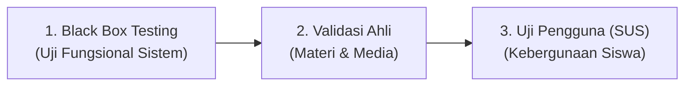

# 🧪 Rencana Pengujian & Validasi Kualitas (Test Plan)

## Multimedia Pembelajaran Interaktif — Sistem Komputer
Dokumen ini merinci instrumen dan metodologi pengujian mutu media pembelajaran berbasis website, mengacu pada **Bab III Proposal Penelitian Pengembangan (Model ADDIE)**.

---

## 1. Kerangka Strategi Pengujian Tiga Tahap

Pengujian produk dilakukan melalui 3 lapisan bertingkat:

---

## 2. Lapisan 1: Black Box Testing (Uji Fungsional)

### 2.1 Metodologi & Skala Guttman
Pengujian fungsional dilakukan dari sudut pandang pengguna tanpa memeriksa kode internal (*functional testing*). Setiap fitur dinilai menggunakan **Skala Guttman**:
- **Skor 1:** Berhasil (fitur berjalan mulus sesuai rancangan)
- **Skor 0:** Gagal (terdapat *bug*, error kalkulasi, atau navigasi macet)

### 2.2 Rumus Feature Completeness (ISO/IEC 25023)
Kesiapan fungsional dihitung menggunakan formula:

$$X = \left( \frac{A}{B} \right) \times 100\%$$

*Keterangan:*
- $X$ = Persentase kelengkapan fitur (*Feature Completeness*)
- $A$ = Jumlah butir uji yang berhasil (skor 1)
- $B$ = Total seluruh butir uji (14 butir)

### 2.3 Kriteria Interpretasi Kelengkapan Fitur
| Rentang Persentase ($X$) | Kategori Kesiapan | Tindak Lanjut |
|---|---|---|
| **100%** | Sangat Lengkap (Siap) | Produk siap dilanjutkan ke tahap validasi ahli |
| **80% – 99%** | Sebagian Besar Lengkap | Fitur yang gagal diperbaiki lalu diuji ulang (*re-test*) |
| **60% – 79%** | Cukup Lengkap | Revisi signifikan pada modul yang bermasalah |
| **< 60%** | Kurang Lengkap | Pembongkaran dan perbaikan struktural sistem |

---

### 2.4 Matriks Butir Uji Black Box (Tabel 3.5 Proposal)

| No | Kode Fitur | Skenario Pengujian | Hasil yang Diharapkan | Kriteria Sukses (Skor 1) |
|---|---|---|---|---|
| 1 | **F01** | Mengakses URL website lewat peramban HP & laptop | Halaman Pembuka terbuka seketika tanpa meminta form pendaftaran/login | Buka langsung < 3 detik |
| 2 | **F02** | Menekan tombol "Lihat Tujuan Pembelajaran" & "Petunjuk" | Tampil informasi 3 sasaran TP dan 6 langkah belajar terstruktur | Modal / section terbuka mulus |
| 3 | **F03** | Mengisi jawaban pada kolom Tantangan Pembuka Unit 1, 2, dan 3 | Jawaban tersimpan di memori lokal, sistem menampilkan umpan balik dan menambah 10 poin | Teks tersimpan + 10 poin |
| 4 | **F04** | Menavigasi segmen materi per layar dengan tombol Lanjut/Kembali | Materi berpindah segmen demi segmen secara sekuensial tanpa loncat | Navigasi materi lancar |
| 5 | **F05** | Menggeser kartu kasus pada aktivitas Drag & Drop Unit 2 | Kartu dapat diseret ke zona Input/Proses/Output; umpan balik warna/teks muncul | Drag & drop responsif di HP |
| 6 | **F06** | Mengetuk komponen pada diagram arsitektur Von Neumann Unit 1 | Kotak penjelasan komponen aktif dan skor eksplorasi bertambah hingga 20 poin | 5 titik interaktif responsif |
| 7 | **F07** | Memilih tebakan pada simulasi CPU Unit 3 | Komponen sirkuit aktif menyala dan status tebakan terverifikasi seketika | Animasi highlight bekerja |
| 8 | **F08a** | Memilih jawaban benar pada kuis formatif | Warna tombol berubah hijau (teal), muncul ikon checklist, poin kuis bertambah | Umpan balik benar muncul |
| 9 | **F08b** | Memilih jawaban salah pada kuis formatif | Warna tombol berubah merah muda, muncul ikon silang, letak salah & petunjuk (*hint*) | Umpan balik salah + hint |
| 10 | **F08c** | Menekan tombol "Ulangi Kuis" setelah seluruh soal selesai | Kuis dapat dikerjakan ulang; skor ketercapaian TP tetap mengunci hasil percobaan pertama | Re-take kuis tidak ubah skor TP |
| 11 | **F09** | Mengisi skala pemahaman, topik sulit, dan esai refleksi | Refleksi tersimpan di memori, umpan balik rekomendasi muncul, dan poin +10 didapat | Refleksi tersimpan + poin |
| 12 | **F10** | Membuka layar Ringkasan Materi & menekan tombol "Salin Intisari" | Teks intisari konsep tersalin ke *clipboard* pengguna secara akurat | Teks tersalin ke clipboard |
| 13 | **F11** | Menyelesaikan seluruh 3 unit belajar dan membuka layar Capaian | Menampilkan total poin kumulatif, predikat level akhir, dan rekap skor 3 TP | Akumulasi nilai 100% tepat |
| 14 | **F15** | Menutup tab peramban, memuat ulang (*refresh*), lalu membuka media lagi | Seluruh skor, poin, dan status centang unit tetap tersimpan rapi via localStorage | Data bertahan tanpa hilang |

---

## 3. Lapisan 2: Validasi Ahli (Materi & Media)

### 3.1 Formula Persentase Kelayakan
Penilaian validator dihitung menggunakan formula:

$$P = \left( \frac{\sum x}{\sum x_i} \right) \times 100\%$$

*Keterangan:*
- $P$ = Persentase skor kelayakan validator
- $\sum x$ = Jumlah skor empiris yang diberikan validator (skala Likert 1–5)
- $\sum x_i$ = Jumlah skor maksimum ideal

### 3.2 Kriteria Kelayakan Hasil Validasi (Tabel 3.9 Proposal)
| Persentase Skor ($P$) | Kategori Kelayakan | Keputusan Pengembangan |
|---|---|---|
| **81% – 100%** | Sangat Layak | Sangat valid, dapat diimplementasikan tanpa revisi besar |
| **61% – 80%** | Layak | Valid, dapat diimplementasikan dengan perbaikan kecil |
| **41% – 60%** | Cukup Layak | Kurang valid, perlu revisi substansial sebelum uji coba |
| **21% – 40%** | Kurang Layak | Tidak valid, perombakan konsep modul |
| **0% – 20%** | Sangat Tidak Layak | Ditolak, rancang ulang secara menyeluruh |

*Batas Kelayakan Minimal:* Produk dinyatakan siap diuji cobakan ke siswa jika memperoleh **minimal 61% (Kategori Layak)** dari kedua ahli.

---

## 4. Lapisan 3: System Usability Scale (SUS) untuk Siswa

### 4.1 Instrumen Kuesioner SUS (10 Pernyataan Baku)

Responden menjawab dengan Skala Likert 1–5:
*(1 = Sangat Tidak Setuju, 2 = Tidak Setuju, 3 = Ragu-Ragu, 4 = Setuju, 5 = Sangat Setuju)*

| No | Pernyataan Instrumen SUS | Tipe Item |
|---|---|---|
| 1 | Saya merasa ingin sering menggunakan website media pembelajaran ini. | Positif (Ganjil) |
| 2 | Saya merasa website media pembelajaran ini terlalu rumit untuk digunakan. | Negatif (Genap) |
| 3 | Saya merasa website media pembelajaran ini mudah digunakan. | Positif (Ganjil) |
| 4 | Saya merasa membutuhkan bantuan orang lain untuk dapat menggunakan website ini. | Negatif (Genap) |
| 5 | Saya merasa berbagai fitur dalam website ini terpadu dengan sangat baik. | Positif (Ganjil) |
| 6 | Saya merasa ada terlalu banyak hal yang tidak konsisten pada website ini. | Negatif (Genap) |
| 7 | Saya merasa sebagian besar orang akan cepat memahami cara menggunakan website ini. | Positif (Ganjil) |
| 8 | Saya merasa website media pembelajaran ini sangat membingungkan saat digunakan. | Negatif (Genap) |
| 9 | Saya merasa sangat percaya diri saat menggunakan website media pembelajaran ini. | Positif (Ganjil) |
| 10 | Saya merasa perlu mempelajari banyak hal terlebih dahulu sebelum mulai menggunakan website ini. | Negatif (Genap) |

### 4.2 Formula Perhitungan Skor SUS
Untuk setiap responden:
- Butir Ganjil (Positif): $\text{Skor Kontribusi} = \text{Skor Jawaban} - 1$
- Butir Genap (Negatif): $\text{Skor Kontribusi} = 5 - \text{Skor Jawaban}$
- Skor Total Responden:

$$\text{Skor SUS} = \left( \sum \text{Skor Kontribusi} \right) \times 2{,}5$$

*Rentang Skor Akhir:* 0 – 100.

### 4.3 Kriteria Interpretasi Kebergunaan (Tabel 3.8 Proposal)
| Rentang Skor SUS | Tingkat Keberterimaan | Kategori Adjektiva | Target Capaian |
|---|---|---|---|
| **> 85** | Acceptable | Best Imaginable / Excellent | Sangat Istimewa |
| **70 – 85** | Acceptable | Good | **Target Kelompok (Skor $\ge 68$)** |
| **51 – 69** | Marginal | OK | Memerlukan perbaikan minor |
| **< 50** | Not Acceptable | Poor / Worst | Tidak dapat diterima pengguna |

---

## 5. Matriks Lingkungan Uji Coba Perangkat (Target Hardware)

| Jenis Perangkat | Spesifikasi Uji Coba | Target Resolusi | Peramban Uji |
|---|---|---|---|
| **Smartphone Android** | Layar 5.5 – 6.5 inci, RAM 3GB | 360×800 s.d. 412×915 px | Chrome Mobile (Versi 110+) |
| **Laptop Pelajar** | Layar 14 inci, OS Windows 10/11 | 1366×768 px | Chrome Desktop / MS Edge |
| **Layar Proyektor Guru** | Rasio 16:9 / 4:3 | 1920×1080 px | Chrome Desktop (Full Screen) |
| **Mode Offline / Putus Jaringan** | Cache lokal setelah aset dimuat | - | Uji tanpa koneksi internet aktif |
