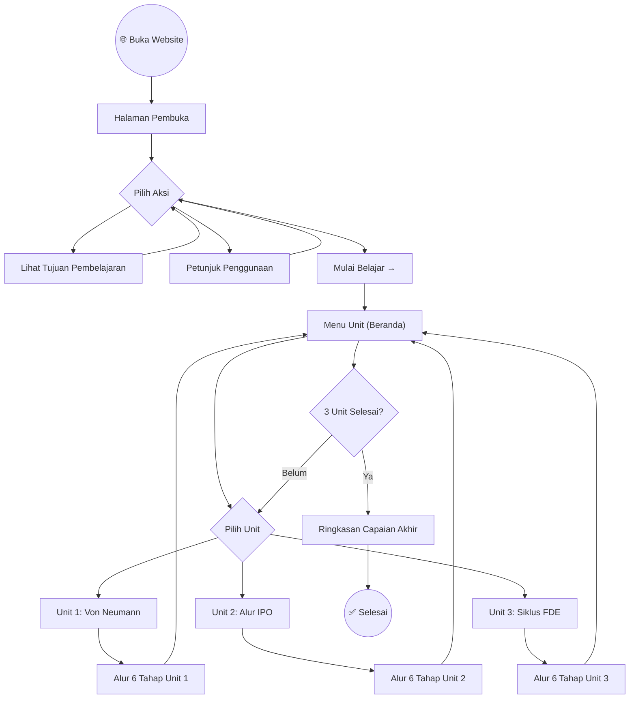
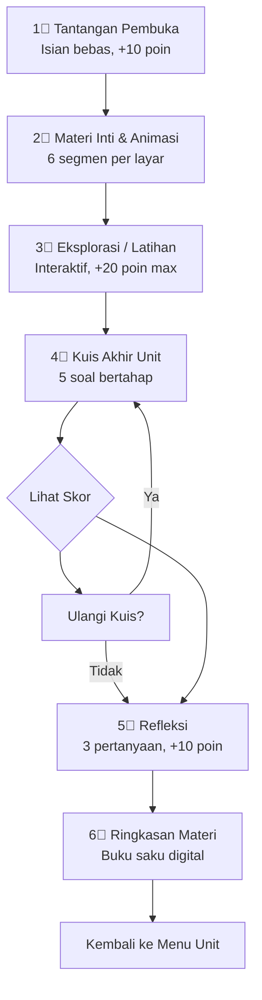
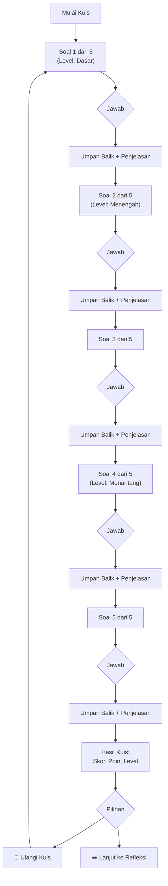
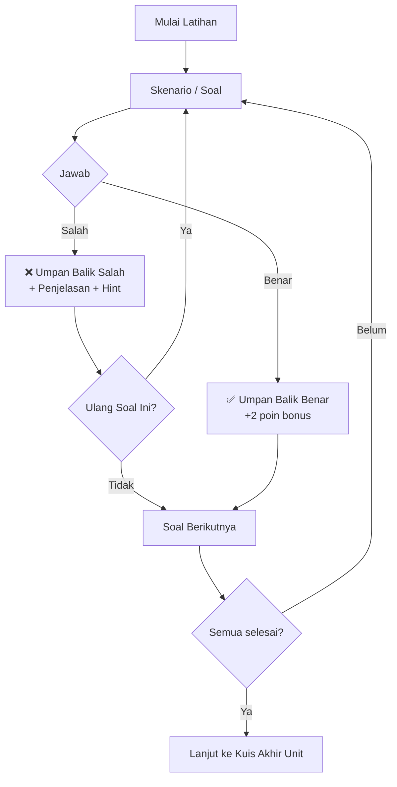
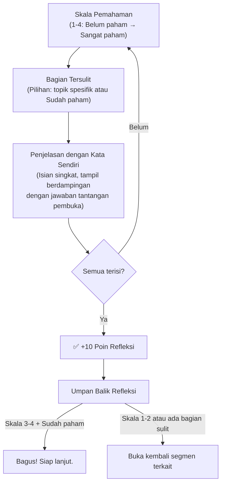
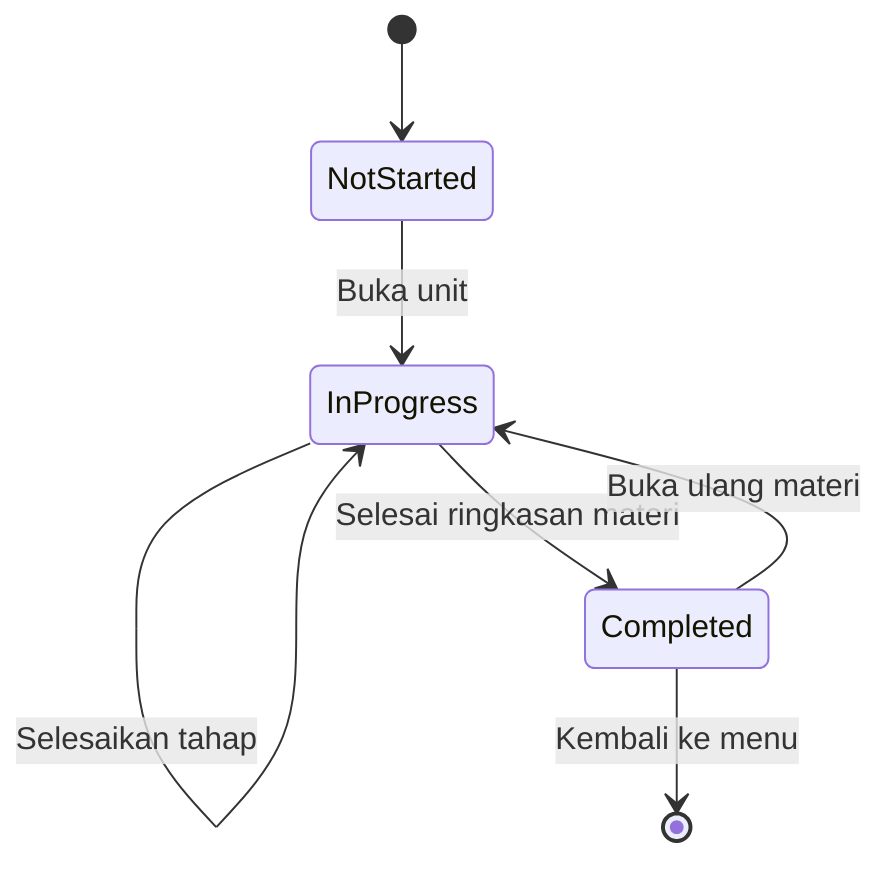

# 🔀 User Flow — Alur Navigasi Pengguna

## Studio Informatika — Perjalanan Belajar Peserta Didik

---

## 1. Alur Utama (Happy Path)

---

## 2. Alur Per Unit (6 Tahap)

Setiap unit mengikuti pola yang **identik dan konsisten**:

---

## 3. Alur Kuis Detail

**Catatan Penting:**
- Umpan balik ditampilkan **langsung setelah menjawab** (per soal)
- Pengulangan kuis hanya bisa dilakukan **setelah semua 5 soal selesai**
- Percobaan ulang **tidak mengubah** skor ketercapaian (yang dicatat = percobaan pertama)

---

## 4. Alur Latihan Soal

**Perbedaan Latihan vs Kuis:**
| Aspek | Latihan Soal | Kuis Formatif |
|---|---|---|
| Pengulangan | Langsung per soal | Setelah semua soal selesai |
| Poin | +2 bonus per soal benar | 12 × skor soal |
| Pengaruh ke skor ketercapaian | ❌ Tidak | ✅ Ya (percobaan pertama) |

---

## 5. Alur Refleksi

---

## 6. Navigasi Global

### 6.1 Dari Halaman Manapun, User Bisa:

| Aksi | Target |
|---|---|
| Klik logo/Beranda di navbar | Kembali ke Beranda (Menu Unit) |
| Klik "← Kembali" | Halaman/tahap sebelumnya |
| Klik menu unit di sidebar/navbar | Langsung ke unit tersebut |

### 6.2 Pembatasan Navigasi

| Aturan | Alasan |
|---|---|
| Semua unit bisa dibuka kapan saja | Peserta didik tidak terhambat |
| Progress bar menunjukkan tahap saat ini | Orientasi posisi dalam alur |
| Navigasi maju: hanya jika tahap saat ini selesai | Menjaga alur belajar berurutan |
| Navigasi mundur: selalu bisa | Memungkinkan review materi |

---

## 7. State Transitions

| Status | Keterangan |
|---|---|
| `not-started` | Unit belum pernah dibuka |
| `in-progress` | Unit sudah dibuka, belum semua tahap selesai |
| `completed` | Semua 6 tahap sudah dilalui |

---

## 8. Edge Cases

| Case | Handling |
|---|---|
| User refresh di tengah kuis | State tersimpan di localStorage; kuis dilanjutkan dari soal terakhir |
| User clear browser data | Data hilang; tampilkan pesan "Mulai dari awal" di Beranda |
| User buka di perangkat berbeda | Data tidak sinkron; harus ulang atau lanjutkan di perangkat asli |
| User buka di incognito | localStorage ada tapi hilang saat tab ditutup; tampilkan warning |
| Koneksi internet terputus setelah load | Media tetap berjalan (semua sudah di browser) |
| User langsung buka URL unit tertentu | Hash router handle → tampilkan unit yang diminta |
